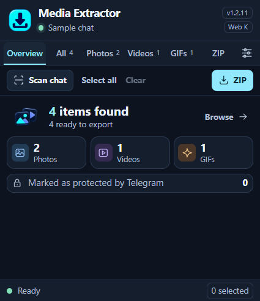
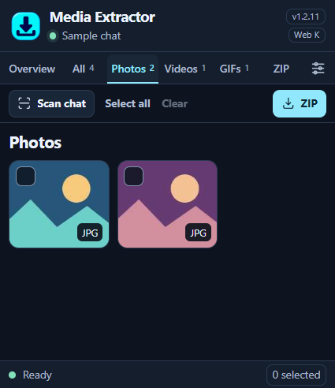
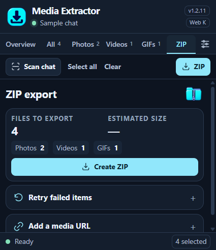

  

<h1 align="center">Telegram Media Extractor</h1>

Find photos, videos, and GIFs in a Telegram Web chat and download them as a ZIP.

Chromium extension · Manifest V3 · Local ZIP processing

## Preview

  
  
  

Screenshots show the actual Brave extension popup with a synthetic sample chat. The logo, media illustration, and ZIP illustration were created with OpenAI ImageGen. The screenshots use the same assets shipped with the extension.

## Install in Brave, Chrome, or Edge

1. Clone this repository or choose **Code → Download ZIP**, then extract it.
2. Open the browser's **Extensions** page and enable **Developer mode**.
3. Select **Load unpacked** and choose the folder containing `manifest.json`.
4. Refresh Telegram Web if it was already open, then open the chat you want to scan.

## Export media

1. Open the extension and choose **Scan chat**. Keep the Telegram Web tab open while it scans and exports.
2. Review **All**, **Photos**, **Videos**, or **GIFs**. Select individual items, or use **Select all** to choose items with loaded sources.
3. Open **ZIP**, review the count and estimated size, and choose **Create ZIP**. With no selection, the extension attempts to export all loaded items in the list.
4. Check `Telegram_Export/Metadata/manifest.json` for saved files, skipped duplicates, and errors.

Telegram Web sometimes delivers GIFs as MP4 files. The extension keeps their original format and places them in the `GIFs` folder. A GIF that is still waiting for its source may become available when you open it in Telegram Web.

### Retry a partial export

Scan the same chat again. Under **ZIP → Retry failed items**, import the previous export's `Metadata/manifest.json` and select **ZIP matched failures**. Loaded items that match failed message IDs go to a separate `Telegram_Recovery_…zip`. Errors without usable message IDs require manual selection.

## Data handling and limits

- The extension works inside your existing Telegram Web session. Media detection, duplicate checks, and ZIP assembly run in the browser.
- An IndexedDB staging cache lets the extension reuse detected photo and GIF bytes for up to 24 hours. Media previews in the popup are optional.
- Export manifests include local message identifiers for retry matching. Treat archives and their manifests as private. The source repository excludes exports, logs, and local browser profiles.
- Export requires a usable media source exposed to the browser. An expired source, an unloaded file, or a playback-only buffer may prevent export. The manifest reports these failures when a partial ZIP is created.
- ZIP files use ZIP32. Very large exports can hit size, entry-count, or browser memory limits.

An independent extension for Telegram Web K and A.
